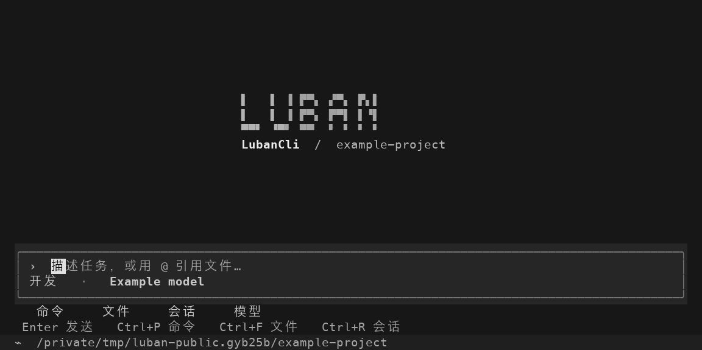

# LubanCli

**终端里的 AI 编程助手。** 在项目目录运行 `luban`，用自然语言查代码、改文件、运行项目检查，再在同一会话继续迭代。



## 安装

需要 [uv](https://docs.astral.sh/uv/) 和 Python 3.12 或更新版本。下载或克隆本仓库后，在源码目录运行：

```sh
uv tool install .
```

如果终端找不到 `luban`，执行 `uv tool update-shell` 后重新打开终端。

## 快速开始

进入要工作的目录，运行 `luban`。空目录也可以作为工作区。

```sh
cd ~/projects/my-app
luban
```

1. 首次启动时填写 OpenAI 兼容端点的 **API 地址**、**模型 ID** 和 **API Key**，然后选择「测试并保存」。免密端点可将 Key 留空，也可在高级设置中指定密钥环境变量。
2. 输入「找出这个项目的入口，说明怎样运行」，按 **Enter** 发送。要换行可用 **Shift+Enter** 或 **Ctrl+J**。
3. 接着输入「给入口补一个冒烟测试，并运行验证」。编辑前可预览差异，命令执行前可核对完整命令。用 `/diff` 查看改动。

## 核心功能

- **代码导航与编辑**：搜索代码、用 `@文件:起始行-结束行` 引用代码，或用 `/symbols` 查找 Python 定义和引用。文件编辑带版本校验和可恢复的检查点。
- **计划与验证**：先用 `/plan on` 制定计划，再用 `/plan execute` 执行。修改后可发现并运行项目检查，将失败结果交回模型修复。
- **持久会话**：按工作区保存对话和工具结果。支持恢复、分叉、上下文压缩，以及会话、项目和全局记忆。
- **模型与扩展**：用 `/model` 配置或切换 OpenAI 兼容端点，通过 `/mcp` 接入 stdio 工具服务，通过 `/skills` 加载工作流程。
- **执行权限**：在 `/permissions` 选择逐项授权、自动编辑或只读模式。默认命令由宿主 shell 执行，系统隔离可在支持的环境中用 `/sandbox on` 开启。

## 常用操作

| 操作 | 快捷键或命令 |
| --- | --- |
| 搜索命令 | `Ctrl+P` |
| 查找并引用文件 | `Ctrl+F` |
| 搜索并恢复会话 | `Ctrl+R` |
| 停止当前任务 | `Esc` 或 `Ctrl+C` |
| 从脚本发起任务并输出 JSON 事件 | `luban run "说明当前项目的入口" --json` |

[运行结果、恢复、MCP 回执和端点评测](docs/runtime.md)
